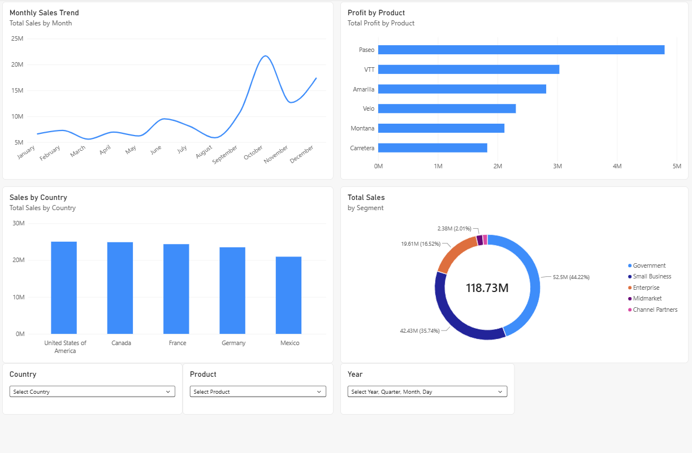

# Sales & Profit Performance Dashboard 

## Project Overview 
This project uses Power BI to analyze sales and probability data for a fictional company ([link](https://learn.microsoft.com/en-us/power-bi/create-reports/sample-financial-download?utm_source=chatgpt.com)). The goal is to transform raw fictional data into an interactive dashboard that helps users understand business performance across products, countries, customer segments and time periods.

## Objectives
- Analyze overall sales, profits and units sold
- Compare profitability across different products
- Explore sales performance across countries
- Understand how sales are distributed across customer segments
- Build an interactive dashboard that allows users to explore the data using filters

## Tools & Technologies
- **Power BI**: Data loading, dashboard development and data visualization
- **Power Query**: Data preparation and cleaning
- **DAX**: Calculated measures and business metrics
- **Excel**: Source dataset

## Dataset 
The project uses Microsoft's Financial Sample Excel workbook which contains fictional financial data, including sales, profit, products, countries, customer segments and dates.
([Source](https://learn.microsoft.com/en-us/power-bi/create-reports/sample-financial-download?utm_source=chatgpt.com))

## Dashboard features
The dashboard includes the following visualizations:
1. **Profit Sales Trend**: A line chart showing changes in sales over time
2. **Profit by Product**: A bar chart comparing profit across products
3. **Sales by Country**: A column chart comparing sales across countries
4. **Sales by Customer Segment**: A donut chart showing the contribution of each customer segment to total sales

## Key Performance Indicators (KPIs)
- Total Sales
- Total Profit
- Total Units Sold
- Profit Margin

## Interative Filters
Users can filter the report by country, product and date to explore different subsets of the data

## Data Preparation
The data was imported into Power BI from Excel and prepared for analysis using Power Query. 

- Columns `Discount Brand`, `Manufacturing Price`, `Sale Price`, `Gross Sales`, `Discounts` and `COGS` were removed since they are unnecessary. 
- A duplicate query `Sheet1` was removed.

## DAX Measures
Examples of the measures used in the dashboard:  

### Total Sales

`Total Sales = SUM(financials[ Sales])`

### Total Profit 

`Total Profit = SUM(financials[Profit])`

### Total Units Sold

`Total Units Sold = SUM(financials[Units Sold])`

### Profit Margin

`Profit Margin =
 DIVIDE(
   [Total Profit],
   [Total Sales],
   0
)`

## Key Insights

- **Product profitability**: Paseo generates the most profit over the course of the year with approximately $4.8M followed by VTT with about $3.05M
- **Geographic performance**: Both United States of America and Canada accounts for the most sales of the year around 25M sales. However, United States of America has a slightly more sales generation than Canada
- **Customer Segments**: Over the year, Government, Small Business and Enterprise contribute to the major of the total sales of the year with 44.22%, 35.74% and 16.52%, respectively

## How to use
- `sales-profit-dashboard.pbix`: Power BI report
- `image/Dashboard.png`: Screenshot of the completed dashboard
- `README.md`: Project documentation

## Future Improvements

- Incorporate SQL for data querying and analysis
- Add year-over-year sales growth and additional time-based metrics
- Improve report accessibility and visualization design
- Develop further analyses of profitability and business performance
